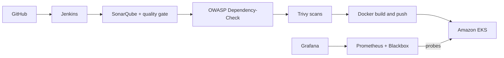

# CI/CD to EKS with Monitoring

A DevOps pipeline project. Jenkins builds a React web app, scans it, pushes a Docker image and deploys it to Amazon EKS, while a Terraform-provisioned EC2 server runs Prometheus, Blackbox Exporter and Grafana to watch uptime. The sample app is a streaming-site UI clone that uses The Movie Database (TMDB) API. It is only a workload for the pipeline, so the project is about the delivery tooling, not the front end.

**Status:** finished demo (2025).


## Pipeline



| Stage | Tool |
|---|---|
| Static analysis and quality gate | SonarQube |
| Dependency scan | OWASP Dependency-Check |
| Filesystem and image scan | Trivy |
| Image build and push | Docker, Docker Hub |
| Deploy | kubectl on EKS (2 replicas, rolling update, LoadBalancer service) |
| Monitoring server | Terraform (AWS EC2 in `ap-south-1`) |
| Uptime probes | Prometheus with Blackbox Exporter (`http_2xx`, `tcp_connect`, `http_post_2xx`) |
| Dashboards | Grafana |
| Notifications | Jenkins email on build result |

## Repository layout

```
Jenkinsfile                          pipeline that builds, scans, pushes and runs the container
K8S/Jenkinsfile                      pipeline variant with the image-scan gate and push
K8S/manifest.yml                     Deployment and Service for the app
K8S/eks-cluster-and-Deployment-guide.txt   notes for creating the EKS cluster
Terraform/                           monitoring EC2 instance and security group
scripts/                             install scripts for Jenkins, Docker, Trivy, kubectl, eksctl, Terraform, Grafana
prometheus-blackbox-config.txt       Blackbox scrape configuration
src/                                 React sample app
```

## Running the sample app locally

```bash
cp .env.example .env     # add a TMDB API key
npm install
npm start                # http://localhost:3000
```

The Jenkins, SonarQube, EKS and Terraform parts need your own AWS account, Jenkins credentials (`github-token`, `Sonar-token`, `docker`) and the tools installed by the scripts in `scripts/`. They have not been re-run since 2025.

## Limitations

- The pushed Docker image is tagged `latest`, not with a commit hash.
- The security group in `Terraform/main.tf` allows SSH from any address. Restrict it before real use.
- The Terraform AWS keys are passed in as variables. Prefer an IAM role or environment credentials.
- Docker Hub image name and notification email are hard-coded in the Jenkinsfiles.

## License

MIT, see [LICENSE](LICENSE).

## Contact

Anubhav Gupta, [LinkedIn](https://www.linkedin.com/in/anubhav-gupta-92410a244/)
